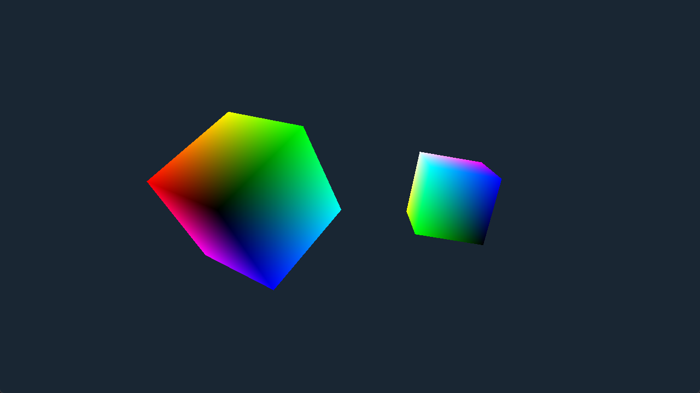
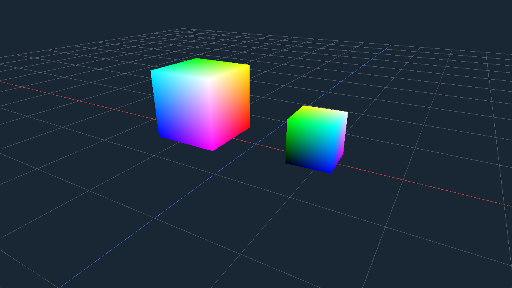
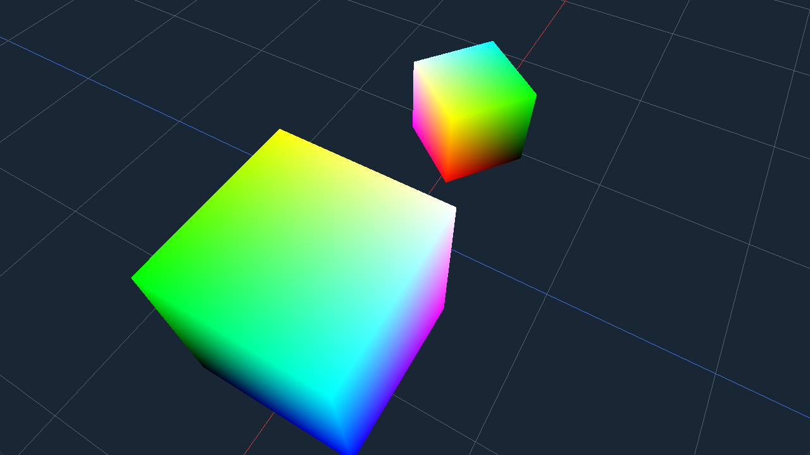

# Graphics Engine

A modern OpenGL graphics engine built from scratch in C++20 as a personal learning project.

The goal of this project is not only to learn modern OpenGL, but also to design a clean, maintainable rendering architecture similar to what would be found in a small game engine.

---

## Tech Stack

- **Language:** C++20
- **Graphics API:** OpenGL 4.6 Core
- **Windowing:** GLFW
- **OpenGL Loader:** GLAD
- **Math Library:** GLM
- **Build System:** CMake + Ninja
- **Package Manager:** vcpkg (manifest mode, see `vcpkg.json`)

---

## Project Structure

```text
assets/
├── shaders/

external/
└── glad/

src/
├── core/
├── graphics/
├── math/
├── scene/
└── utils/
```

---

## Current Architecture

```text
Application
│
├── Window
│
└── Renderer
    │
    ├── Shader
    └── Mesh
```

---

## Screenshots

### First Triangle (v0.1.0)

<details>
  <summary></summary>
  
  
  
</details>

### Transforms

<details>
  <summary></summary>
  
  One indexed cube mesh drawn twice with different model matrices, under a perspective projection.

  
  
</details>

### Orbit Camera

<details>
  <summary></summary>
  
  Default view of the ground grid (red X axis, blue Z axis), then after a left-drag orbit and scroll zoom.

  
  
  
</details>

---

## Planned Roadmap

**MVP goal:** load multiple 3D models (OBJ, STL) into a scene, with lighting and textures.

- [x] Window creation
- [x] OpenGL initialization
- [x] Shader abstraction
- [x] Mesh abstraction
- [x] Render first triangle
- [x] Vertex colors
- [x] Engineering cleanup (vcpkg manifest, move-only GPU resources, GL debug output)
- [x] Index buffers (EBOs)
- [x] Shader uniforms + transform system
- [x] Orbit camera (left drag: orbit, right/middle drag: pan, scroll: zoom, R: reset)
- [ ] Normals + basic lighting
- [ ] CPU mesh data / GPU mesh split, Model class
- [ ] OBJ loader (hand-written)
- [ ] STL loader (hand-written, ASCII + binary)
- [ ] Auto-framing (bounding boxes, camera fit, up-axis)
- [ ] Multiple models in a scene
- [ ] Texture loading + OBJ materials (.mtl)
- [ ] File loading UX (command line, drag-and-drop)
- [ ] Engine MVP

### Post-MVP

- [ ] Dear ImGui editor UI (file browser, scene panel)
- [ ] Scene graph

---

## Building

### Requirements

- CMake 3.20+
- Ninja
- MSYS2 MinGW
- vcpkg

### Clone

```bash
git clone --recursive <repo-url>
cd GraphicsEngine
./vcpkg/bootstrap-vcpkg.bat
```

### Configure

Dependencies (GLFW, GLM) are installed automatically from `vcpkg.json` on first configure.

```bash
cmake --preset default
```

### Build

```bash
cmake --build --preset default
```

### Run

Run from the repository root so `assets/` paths resolve:

```bash
./build/GraphicsEngine.exe
```

---

## Purpose

This repository serves as a long-term graphics programming journal. Rather than following a tutorial verbatim, each feature is implemented incrementally with an emphasis on understanding the underlying graphics pipeline, engine architecture, and modern C++ design.
